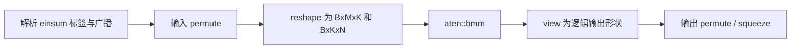

# PyTorch 代表性 Trace 对比分析报告

生成日期：2026-10-10  
正式实验目录：`/root/benchmark/tensor_contraction_redesign/results/contraction_cpu0-3_20261009T163753742611Z`  
对齐 Trace 目录：`/root/trace/traces`  
分析对象：6 个代表性用例、2 种 PyTorch 实现，共 12 份 Chrome Trace

## 1. 结论摘要

1. 在这 6 个代表性用例中，`pytorch_2.5.0_kml_patched` 的正式端到端中位数均优于 `pytorch_2.5.0_openblas`，中位数加速比为 **1.763x 至 2.713x**，P95 加速比为 **1.722x 至 2.519x**。
2. 该结果不能解释成“只替换 BLAS 后的纯 KML 加速”。两种方法同时存在 PyTorch 源码、CPU `bmm` 路径、编译器、ABI、MKLDNN/Kineto 配置和 BLAS 库差异。它衡量的是两个完整软件栈。
3. 两种实现的 `einsum` 上层规约方式相同：先对输入做 `permute/reshape`，再调用 `aten::bmm`，最后通过 `view/permute` 恢复逻辑输出。主要差异位于 CPU `bmm`：KML 补丁直接根据 stride 选择转置标志，逐 batch 调用 KML GEMM，并通过 `at::parallel_for` 并行 batch。
4. 连续布局 `L0` 中，OpenBLAS 路径的 `bmm` 内部仍出现一次 RHS 连续化，trace 中物化 self time 为 27.302 us；KML 路径没有对应物化，正式中位数从 105.692 us 降到 53.558 us。
5. 长归约维 `G3`（`M=N=32, K=1024`）中，OpenBLAS 路径在 `bmm` 内物化约 128 KiB 的 RHS；KML 路径不需要该复制。正式中位数加速达到 2.691x。
6. `batch=64, threads=4` 用例中，两侧都没有可见物化；KML 路径的主要优势来自 batch 外层并行。CPU 核心利用率从 25.24% 提升到 91.05%，端到端中位数加速 2.713x。
7. 交错布局 `L3` 与最后一维 stride=2 的 `L4` 都迫使两个输入发生物化。固定的数据搬运稀释了 KML 的 GEMM 优势，因此端到端加速回落到约 1.76x。
8. `L5` 在被计时的操作内部显式调用两次 `.contiguous()`。它没有改善单次缩并：相对 `L4`，OpenBLAS 中位数增加 2.4%，KML 中位数增加 0.14%。只有连续化结果能跨多次缩并复用时，预物化才可能有收益。
9. Trace 只适合解释调用结构和复制位置，不能替代正式性能数据。单次 profiler 的 `benchmark::operation` 时长是正式中位数的 2.55x 至 7.34x。

## 2. 数据口径与可比性

### 2.1 正式计时

- 每个方法、每个用例运行 3 个 campaign。
- 每个 campaign 预热 10 次、正式计时 50 次，共 150 个正式样本。
- 计时范围是完整 `torch.einsum` 调用，使用 `time.perf_counter_ns()`。
- 正式计时期间禁用 Python GC；每个用例固定 CPU affinity。
- 单线程用例固定 CPU 3；4 线程用例固定 CPU 0-3。
- 环境变量将 OpenBLAS、OMP、MKL 等库线程数设为 1；PyTorch intra-op 线程数按用例设置，interop 线程固定为 1。
- 所有代表性用例的逻辑计算量固定为 2,097,152 FLOPs，即 `2 * B * M * N * K`。

### 2.2 Trace 采集

- Trace 是正式计时完成后执行的另一次独立 `torch.profiler` 调用。
- 每份 trace 只包含 campaign 0 的一次操作，不是 150 个正式样本之一。
- profiler 启用 `record_shapes=True`，并用 `benchmark::operation` 包住一次 `torch.einsum`。
- 诊断分类采用 ATen 事件的父子关系：物化事件、元数据 view 事件、`aten::bmm` 容器和 `aten::einsum` 自身时间。
- `input_materialize_self_ns` 等字段是被归类事件的 **self CPU time 之和**；`bmm_container_ns` 是 `aten::bmm` 的 inclusive CPU time。二者不能直接相加构造新的总时间。

### 2.3 对齐文件的处理

目录中的 12 份 trace 已做以下处理：

- 将每个 `benchmark::operation` 的起点统一平移到 1000 us。
- 只平移时间戳，不改变任何事件持续时间。
- 移除操作时间窗外的带时间戳事件。每份 OpenBLAS trace 删除 11 个外围事件，KML trace没有删除外围事件。
- 给 `pid` 添加“方法 + 用例”前缀，避免 Perfetto 合并不同文件的轨道。
- 去除 OpenBLAS trace 的绝对 `baseTimeNanoseconds`；将 KML 的列表格式统一封装为 Chrome Trace 对象。
- 原始文件与对齐文件的 SHA-256 对照记录在 `alignment_manifest.tsv`。

因此，多文件在 Perfetto 中可直接从同一横坐标比较相对结构；它们仍是互相独立的运行，不表示真实的同时执行或共同墙钟。

## 3. 方法身份

| 项目 | `pytorch_2.5.0_openblas` | `pytorch_2.5.0_kml_patched` | 对解释的影响 |
| --- | --- | --- | --- |
| `torch.__version__` | `2.5.0` | `2.5.0a0+git32f585d` | 不是同一二进制构建 |
| BLAS 配置 | `BLAS_INFO=open` | `BLAS_INFO=KML` | 后端不同 |
| 实际加载库 | OpenBLAS 0.3.25 | `libkblas.so.1.26.1.RC1`，SVE locking 路径 | KML 针对鲲鹏/SVE |
| 编译器 | GCC 10.2 | BiSheng 5.2.0 的 clang 19.1.7 | 编译器也可能影响框架开销 |
| C++ ABI | `_GLIBCXX_USE_CXX11_ABI=0` | `_GLIBCXX_USE_CXX11_ABI=1` | 构建整体不同 |
| MKLDNN | ON | OFF | 非 BLAS 算子路径可能不同 |
| Kineto | `USE_KINETO` | 配置中未启用 | 两套 profiler 的事件参数和开销不可直接等同 |
| CPU `bmm` | 官方 2.5.0 路径 | KPEX 补丁路径 | KML 结果包含框架级补丁收益 |

这是一组有价值的“官方 PyTorch 栈 vs 鲲鹏定制 PyTorch 栈”系统比较，但不是严格控制变量的“OpenBLAS vs KML”微基准。

## 4. PyTorch 的实现路径

### 4.1 公共 `einsum` lowering

PyTorch `sumproduct_pair` 将两个操作数的维度分成：

- `lro`：左右输入和输出都保留的维度，折叠成 batch。
- `lo`：只来自左输入的自由维，折叠成矩阵 `M`。
- `ro`：只来自右输入的自由维，折叠成矩阵 `N`。
- `sum_dims`：缩并维，折叠成矩阵 `K`。

执行链为：



对应源码：

- `/root/benchmark/pytorch-kunpeng/pytorch-v2.5.0/aten/src/ATen/native/Linear.cpp:142-145`
- `/root/benchmark/pytorch-kunpeng/pytorch-v2.5.0/aten/src/ATen/native/Linear.cpp:185-232`

`permute` 本身通常只是元数据操作；随后的 `reshape` 只有在现有 stride 能合并时才是 view，否则会触发 clone/copy。输出侧在这 6 个用例中只观察到 view/permute，没有输出物化，因此没有物理 restore copy。

### 4.2 官方 OpenBLAS 路径

KPEX patch 的上下文显示，官方 CPU `bmm` 在该分支上按 batch 循环，并对每个切片调用 `addmm_impl_cpu_`：

```cpp
for (const auto b : c10::irange(bs)) {
    auto r = self_or_result.select(0, b);
    addmm_impl_cpu_(r, r, batch1.select(0, b), batch2.select(0, b), 0, 1);
}
```

该路径对某些由 `einsum` 产生的合法转置 stride 仍会做 `.contiguous()`。在 `L0` 和 `G3` trace 中，复制明确位于 `aten::bmm` 内部。

### 4.3 KML 补丁路径

KML 补丁新增 `bmm_impl_cpu_`，主要行为是：

1. 检查结果、左矩阵和右矩阵 stride，尽量用 `transpose_a/transpose_b/transpose_c` 表达现有布局。
2. 只有 stride 不能作为常规或转置矩阵传给 BLAS 时才 clone。
3. 使用 `at::parallel_for(0, bs, 1, ...)` 在 batch 维分工。
4. 每个 batch 直接调用 `at::native::cpublas::gemm`，最终进入 KML BLAS。

对应源码：

- `/root/benchmark/pytorch-kunpeng/pytorch-v2.5.0/aten/src/ATen/native/LinearAlgebra.cpp:1588-1718`
- `/root/benchmark/pytorch-kunpeng/kpex-current/thirdparty/pytorch-v2.5.0.patch:360-490`
- 官方循环被替换的位置：同一 patch 的 `:514-523`

因此，KML 的优势同时可能来自：更适合鲲鹏 920 的 GEMM、避免不必要的连续化，以及 batch 级并行。

## 5. 代表性用例

| 用例 | 目的 | einsum | B, M, N, K | 输入/输出逻辑最低字节 | 算术强度 |
| --- | --- | --- | --- | ---: | ---: |
| `R4_Q2_G0_D0_L0_B1_T1` | 4D、2 个缩并维、连续基准 | `abpq,ghpq->abgh` | 1, 128, 128, 64 | 131,072 B | 16.00 FLOP/B |
| `R4_Q2_G0_D0_L3_B1_T1` | 自由维与缩并维交错 | `apbq,gqhp->abgh` | 1, 128, 128, 64 | 131,072 B | 16.00 FLOP/B |
| `R4_Q2_G0_D0_L4_B1_T1` | 最后一维 stride=2 | `abpq,ghpq->abgh` | 1, 128, 128, 64 | 131,072 B | 16.00 FLOP/B |
| `R4_Q2_G0_D0_L5_B1_T1` | stride=2，计时内显式连续化 | `abpq,ghpq->abgh` | 1, 128, 128, 64 | 131,072 B | 16.00 FLOP/B |
| `R6_Q3_G3_D0_L0_B1_T1` | 6D、3 个缩并维、长 K | `abcpqr,ghipqr->abcghi` | 1, 32, 32, 1024 | 266,240 B | 7.88 FLOP/B |
| `R6_Q3_BATCH_B64_T4` | 64 个小 GEMM、4 线程 | `zabcpqr,zghipqr->zabcghi` | 64, 32, 32, 16 | 524,288 B | 4.00 FLOP/B |

“逻辑最低字节”只计算每个逻辑输入读取一次和输出写入一次，不包含 cache 重读、写分配、临时张量、packing 或底层库内部流量，不能称为实测内存带宽。

布局构造口径：

- `L0`：两个输入按 equation 标签顺序连续存储。
- `L3`：测试前先 `permute(...).contiguous()`，得到物理上连续、但标签顺序交错的输入；这次准备工作不在计时内。
- `L4`：从最后一维扩大两倍的 storage 取 `[..., ::2]`，两个输入均为非连续 stride=2 view；准备工作不在计时内。
- `L5`：输入与 `L4` 相同，但被计时的 lambda 内显式执行 `a.contiguous()` 和 `b.contiguous()` 后再调用 `einsum`。
- Batch 用例的 payload rank 是 6，额外 batch 轴使 physical rank 为 7。

## 6. 正式端到端性能

单位：时间为 ns；性能为 GFLOP/s；Speedup = OpenBLAS 时间 / KML 时间。

| 用例 | Open 中位数 | Open P95 | Open GFLOP/s | KML 中位数 | KML P95 | KML GFLOP/s | 中位数 Speedup | P95 Speedup |
| --- | ---: | ---: | ---: | ---: | ---: | ---: | ---: | ---: |
| `R4...L0` | 105,692 | 124,469 | 19.842 | 53,558 | 67,395 | 39.157 | 1.973x | 1.847x |
| `R4...L3` | 118,193 | 138,929 | 17.743 | 67,035 | 79,165 | 31.284 | 1.763x | 1.755x |
| `R4...L4` | 116,753 | 136,849 | 17.962 | 66,074 | 79,485 | 31.739 | 1.767x | 1.722x |
| `R4...L5` | 119,563 | 144,079 | 17.540 | 66,164 | 83,635 | 31.696 | 1.807x | 1.723x |
| `R6...G3` | 159,280 | 182,002 | 13.166 | 59,199 | 72,244 | 35.425 | 2.691x | 2.519x |
| `R6...B64T4` | 109,232 | 124,229 | 19.199 | 40,262 | 51,643 | 52.088 | 2.713x | 2.406x |

绝对 P95 在所有 6 个用例中仍由 KML 更优，但 KML 的 `P95 / median` 增幅不总是更小：

| 用例 | Open P95 高于中位数 | KML P95 高于中位数 |
| --- | ---: | ---: |
| `R4...L0` | 17.8% | 25.8% |
| `R4...L3` | 17.5% | 18.1% |
| `R4...L4` | 17.2% | 20.3% |
| `R4...L5` | 20.5% | 26.4% |
| `R6...G3` | 14.3% | 22.0% |
| `R6...B64T4` | 13.7% | 28.3% |

所以当前数据支持“KML 的绝对尾延迟更低”，不支持“KML 的相对抖动总是更小”。

## 7. PyTorch Profiler 诊断表

下表全部来自一次独立 profiler 调用，单位为 us。`Mat-in` 是 `bmm` 前的输入物化 self time；`Mat-bmm` 是 `bmm` 子树内的物化 self time；`Meta` 是 `bmm` 外的 view/reshape/permute 等元数据操作 self time。所有代表性 trace 的输出物化均为 0。

| 用例 | 方法 | Operation | Einsum | Planner self | Mat-in self | BMM container | Mat-bmm self | Meta self | 事件数 |
| --- | --- | ---: | ---: | ---: | ---: | ---: | ---: | ---: | ---: |
| `R4...L0` | Open | 376.614 | 226.345 | 31.823 | 0.000 | 139.109 | 27.302 | 55.413 | 34 |
| `R4...L0` | KML | 266.598 | 120.087 | 24.770 | 0.000 | 47.493 | 0.000 | 47.824 | 31 |
| `R4...L3` | Open | 433.288 | 271.777 | 39.841 | 47.403 | 126.429 | 0.000 | 55.134 | 37 |
| `R4...L3` | KML | 353.543 | 188.912 | 32.592 | 43.863 | 48.493 | 0.000 | 61.073 | 40 |
| `R4...L4` | Open | 418.488 | 261.517 | 35.562 | 0.000 | 165.271 | 40.983 | 60.684 | 39 |
| `R4...L4` | KML | 346.632 | 184.702 | 34.512 | 0.000 | 95.966 | 38.943 | 54.224 | 38 |
| `R4...L5` | Open | 394.586 | 186.522 | 25.820 | 49.004 | 116.778 | 13.071 | 43.924 | 44 |
| `R4...L5` | KML | 347.753 | 120.798 | 24.490 | 59.683 | 48.893 | 0.000 | 47.415 | 41 |
| `R6...G3` | Open | 405.736 | 255.997 | 35.281 | 0.000 | 163.231 | 44.773 | 57.485 | 38 |
| `R6...G3` | KML | 270.768 | 124.408 | 25.812 | 0.000 | 51.653 | 0.000 | 46.943 | 35 |
| `R6...B64T4` | Open | 394.746 | 243.176 | 38.542 | 0.000 | 141.410 | 0.000 | 63.224 | 33 |
| `R6...B64T4` | KML | 295.669 | 129.649 | 31.901 | 0.000 | 38.252 | 0.000 | 59.496 | 35 |

Trace 中的 BMM 容器时长比值（Open / KML）依次为 2.929x、2.607x、1.722x、2.388x、3.160x 和 3.697x。该比值包含 `bmm` 内复制与调度开销，不等价于底层 GEMM 微内核加速比。

## 8. 分用例解读

### 8.1 `R4_Q2_G0_D0_L0_B1_T1`：连续基准

- 降维后的 BMM 为 `[1,128,64] x [1,64,128]`。
- Open trace 记录的 RHS stride 为 `[64,1,64]`。官方路径在 `aten::bmm` 内调用 `aten::contiguous -> aten::clone -> aten::copy_`，物化 self time 合计 27.302 us。
- KML 补丁把该 stride 表达为 BLAS 转置，不需要 clone。
- 正式端到端加速 1.973x；trace BMM 容器加速 2.929x。

这说明即使原始高阶输入连续，`einsum` 的重排也可能把 RHS 变成“逻辑合法但不满足官方 `bmm` 快速路径”的 stride。KML 补丁的价值不只在微内核，也在框架与 BLAS 之间的布局适配。

### 8.2 `R4_Q2_G0_D0_L3_B1_T1`：交错标签布局

- 输入以 `apbq` 和 `gqhp` 的物理顺序连续存储。
- 为形成 `[M,K]` 与 `[K,N]`，自由维和缩并维必须重新聚合；对应 reshape 不能保持为纯 view。
- 两种方法都在 BMM 前物化两个输入：Open 为 47.403 us，KML 为 43.863 us。
- BMM 本身仍是 KML 更快，但总加速下降到 1.763x。

这里的数据搬运发生在公共 `einsum` lowering 内，换 BLAS 无法消除。要进一步优化必须改变 contraction planner、使用能直接消费 block-scatter/任意 stride 的后端，或复用预变换输入。

### 8.3 `R4_Q2_G0_D0_L4_B1_T1`：最后一维 stride=2

- 两个输入都来自 `storage[..., ::2]`。
- 上层 reshape 仍可保留 alias，但 BMM 的矩阵 stride 不能直接交给两条 BLAS 路径。
- 两侧都在 `bmm` 内物化两个输入：Open 为 40.983 us，KML 为 38.943 us。
- 正式端到端加速为 1.767x，低于连续布局的 1.973x。

KML 对常规转置 stride 的接受范围更宽，但并不等于支持任意 stride。stride=2 的矩阵内维仍需要复制。

### 8.4 `R4_Q2_G0_D0_L5_B1_T1`：显式连续化

- 被计时操作先执行 `a.contiguous()` 和 `b.contiguous()`，然后调用 `einsum`。
- KML 的两次输入物化 self time 为 59.683 us，之后 `bmm` 不再 clone。
- Open 的两次显式物化为 49.004 us，但 `einsum` 重排出的 RHS 仍在 `bmm` 内产生 13.071 us 物化，合计 62.075 us。
- 与 `L4` 相比，Open 正式中位数由 116.753 us 上升到 119.563 us；KML 由 66.074 us 上升到 66.164 us。

对于只计算一次的输入，显式 `.contiguous()` 主要是移动复制位置，并没有减少总工作量。更有参考价值的后续实验是把连续化放到计时外，并对同一连续副本重复缩并，测量摊销临界次数。

### 8.5 `R6_Q3_G3_D0_L0_B1_T1`：长 K

- 降维后的 BMM 为 `[1,32,1024] x [1,1024,32]`。
- Open 路径在 BMM 内复制 RHS，逻辑大小为 `1024 * 32 * 4 = 131,072 B`，trace 物化 self time 为 44.773 us。
- KML 路径不复制 RHS，BMM 容器从 163.231 us 降到 51.653 us。
- 正式端到端中位数从 159.280 us 降到 59.199 us，加速 2.691x。

该用例同时放大了 KML GEMM 和布局适配的收益，不能仅凭 trace 将二者进一步拆开。若需要纯 kernel 对比，应直接调用相同形状、相同转置标志的 OpenBLAS/KML GEMM，并将 packing 与 kernel 单独插桩。

### 8.6 `R6_Q3_BATCH_B64_T4`：64 个小 GEMM、4 线程

- 降维后的 BMM 为 `[64,32,16] x [64,16,32]`。
- 两侧 trace 都没有可见输入或 BMM 内物化，排除了复制差异作为主要原因。
- OpenBLAS 路径核心利用率中位数为 25.24%，接近 4 核配额中的 1 核；KML 补丁为 91.05%。
- KML `bmm_impl_cpu_` 的 `at::parallel_for(0, bs, 1, ...)` 能把 64 个 batch 分给 4 个 PyTorch worker。
- 正式端到端加速 2.713x，trace BMM 容器加速 3.697x。

这组结果是当前 trace 中最直接的“框架调度优化”证据。它说明小 GEMM 的单次核性能不是唯一决定因素，能否在 batch 维并行同样关键。

## 9. 布局敏感性

相对同形状连续布局 `L0` 的正式中位数惩罚如下：

| 布局 | OpenBLAS 惩罚 | KML 惩罚 | 主因 |
| --- | ---: | ---: | --- |
| `L0` | 0.0% | 0.0% | Open 内部复制 RHS；KML 用转置标志避免复制 |
| `L3` | 11.8% | 25.2% | 公共 lowering 在 BMM 前物化两个输入 |
| `L4` | 10.5% | 23.4% | BMM 内物化两个 stride=2 输入 |
| `L5` | 13.1% | 23.5% | 计时内显式物化；Open 还会再次物化 RHS |

KML 的相对布局惩罚更大，不代表其绝对性能更差。原因是 KML 的连续基准更快，固定复制成本在总时间中的占比更高；四种布局中 KML 的绝对中位数仍全部优于 OpenBLAS。

## 10. 阶数、缩并维、K 和 batch 的解释边界

- 当前 4D `L0/L3/L4/L5` 组严格控制了逻辑 `M/N/K`，可以归因于布局。
- `R6...G3` 同时改变了 payload rank、缩并维数、自由维分解和 K，不能仅据它断言“6D 比 4D 更快/更慢”或“3 个缩并维本身导致某结果”。
- `R6...B64T4` 同时改变 batch、K 和线程数，主要用于验证 batch 并行，不是单独的线程扩展性实验。
- 要隔离 rank 或缩并维数，应追加 R4/R5/R6 在同一 `G0/D0/L0/B1/T1` 下的 trace，并保持相同 `M/N/K`。
- 要隔离线程扩展，应固定 batch=64、`M/N/K=32/32/16`，分别运行 T1/T2/T4，并报告 speedup、parallel efficiency 和核心利用率。

## 11. 正确性结果

| 用例 | Open 最大相对误差 | KML 最大相对误差 |
| --- | ---: | ---: |
| `R4...L0` | 6.266e-7 | 6.266e-7 |
| `R4...L3` | 6.266e-7 | 6.266e-7 |
| `R4...L4` | 6.266e-7 | 6.266e-7 |
| `R4...L5` | 6.266e-7 | 6.266e-7 |
| `R6...G3` | 1.449e-6 | 3.448e-7 |
| `R6...B64T4` | 2.757e-7 | 2.161e-7 |

这些数值说明 FP32 结果与各自环境中的 FP64 `torch.einsum` reference 接近。但 reference 使用同一个框架与同一个 equation lowering，不是独立 contraction oracle；共同的标签解析或 lowering 错误可能同时影响待测结果和 reference。因此它是数值误差检查，不是完整的语义正确性证明。

## 12. Trace 能回答和不能回答的问题

### 12.1 能回答

- `einsum` 是否规约为 `bmm`。
- 输入重排是纯 view 还是触发 clone/copy。
- clone/copy 位于 `bmm` 之前、`bmm` 内部还是输出侧。
- BMM 的逻辑形状，以及 OpenBLAS/Kineto trace 中的输入 stride。
- 多 batch 路径是否表现出更高的进程 CPU 时间和核心利用率。
- 输出恢复是否只是元数据操作；本组选例没有观察到输出物化。

### 12.2 不能直接回答

- 底层 KML/OpenBLAS 微内核的纯执行时间。外部 BLAS 内部没有 ATen 子事件。
- BLAS 内部 packing 与 kernel 的独立耗时。
- 实际 DDR 带宽或 cache 层级流量。当前 ECS 未向 guest 暴露 ARM PMU/HiSilicon uncore 计数器。
- 两个 build 的 profiler 时长能否逐项作为严格性能对比。Open build 启用 Kineto，KML build 的 trace 更简化且 event args 为空。
- 单次 profiler trace 是否代表中位数或 P95。它没有重复采样，而且 profiler 开销很大。

## 13. Profiler 开销

| 用例 | Open trace Operation / 正式中位数 | KML trace Operation / 正式中位数 |
| --- | ---: | ---: |
| `R4...L0` | 3.56x | 4.98x |
| `R4...L3` | 3.67x | 5.27x |
| `R4...L4` | 3.58x | 5.25x |
| `R4...L5` | 3.30x | 5.26x |
| `R6...G3` | 2.55x | 4.57x |
| `R6...B64T4` | 3.61x | 7.34x |

因此报告中的 trace 数值只用于解释事件结构。性能结论一律以 150 个正式样本汇总的中位数和 P95 为准。

## 14. 建议的后续实验

1. **预物化复用实验**：分别测试原始非连续输入、计时内 `.contiguous()`、计时外一次 `.contiguous()` 后重复使用 1/2/4/8/16 次，寻找复制成本的摊销临界点。
2. **纯 GEMM 控制实验**：固定 BMM 形状和 stride/transpose 标志，直接调用 OpenBLAS 与 KML，分离后端 kernel 收益和 PyTorch `bmm` 补丁收益。
3. **框架补丁消融**：在同一编译器、同一 PyTorch commit、同一构建选项下构建四组：OpenBLAS 官方 bmm、OpenBLAS patched bmm、KML 官方 bmm、KML patched bmm。
4. **rank 控制实验**：加入 R4/R5/R6 且 `M/N/K` 完全一致的 trace，单独评估高阶标签解析、permute 和 reshape 元数据开销。
5. **线程扩展实验**：对 batch=64 固定输入运行 T1/T2/T4；除端到端时间外，记录 CPU time、核心利用率和 parallel efficiency。
6. **更深的 BLAS 插桩**：在 `cpublas::gemm` 调用周围增加轻量 marker，或对 KML/OpenBLAS 接口做 wrapper，避免把 `aten::bmm` 容器误称为纯 kernel 时间。
7. **独立正确性 oracle**：用显式索引循环或独立 contraction 实现生成小规模 reference，覆盖 equation 标签和布局语义。
8. **真实带宽实验**：若迁移到裸机或支持 PMU passthrough 的实例，使用 ARM PMU 与 HiSilicon DDRC/L3C/HHA uncore 事件测量实际流量；当前“最低有效带宽”继续明确标为估算值。

## 15. 证据索引

- 正式汇总：`/root/benchmark/tensor_contraction_redesign/results/contraction_cpu0-3_20261009T163753742611Z/summary.tsv`
- 原始样本：`/root/benchmark/tensor_contraction_redesign/results/contraction_cpu0-3_20261009T163753742611Z/raw/`
- PyTorch 诊断：`/root/benchmark/tensor_contraction_redesign/results/contraction_cpu0-3_20261009T163753742611Z/diagnostics/`
- 构建与运行元数据：`/root/benchmark/tensor_contraction_redesign/results/contraction_cpu0-3_20261009T163753742611Z/metadata/`
- 原始 trace：`/root/benchmark/tensor_contraction_redesign/results/contraction_cpu0-3_20261009T163753742611Z/traces/`
- 对齐 trace：`/root/trace/traces/*.json`
- 对齐清单：`/root/trace/traces/alignment_manifest.tsv`
- Benchmark 实现：`/root/benchmark/tensor_contraction_redesign/benchmark_pytorch.py`
- Case 生成：`/root/benchmark/tensor_contraction_redesign/generate_cases.py`
- 运行编排：`/root/benchmark/tensor_contraction_redesign/run_experiment.py`
- Trace 对齐脚本：`/root/benchmark/tensor_contraction_redesign/prepare_aligned_traces.py`
- PyTorch einsum lowering：`/root/benchmark/pytorch-kunpeng/pytorch-v2.5.0/aten/src/ATen/native/Linear.cpp`
- KML patched BMM：`/root/benchmark/pytorch-kunpeng/pytorch-v2.5.0/aten/src/ATen/native/LinearAlgebra.cpp`
- KPEX 补丁：`/root/benchmark/pytorch-kunpeng/kpex-current/thirdparty/pytorch-v2.5.0.patch`

## 16. 总结

这 12 份 trace 与正式性能数据共同支持以下判断：KML 定制 PyTorch 的收益来自“鲲鹏优化 GEMM + 更宽松的转置 stride 处理 + batch 外层并行”三部分。连续与长 K 用例主要体现后端和复制消除；多 batch 用例主要体现框架并行；交错或任意 stride 布局则暴露公共 `einsum` lowering 的物化成本。当前最重要的工程结论不是“KML 对所有布局都等比例更快”，而是：**当输入能被规约为 BLAS 可接受的常规/转置 stride 时，KML 路径优势最大；一旦必须全量物化，数据搬运会成为端到端加速的上限。**
